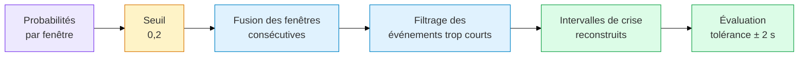
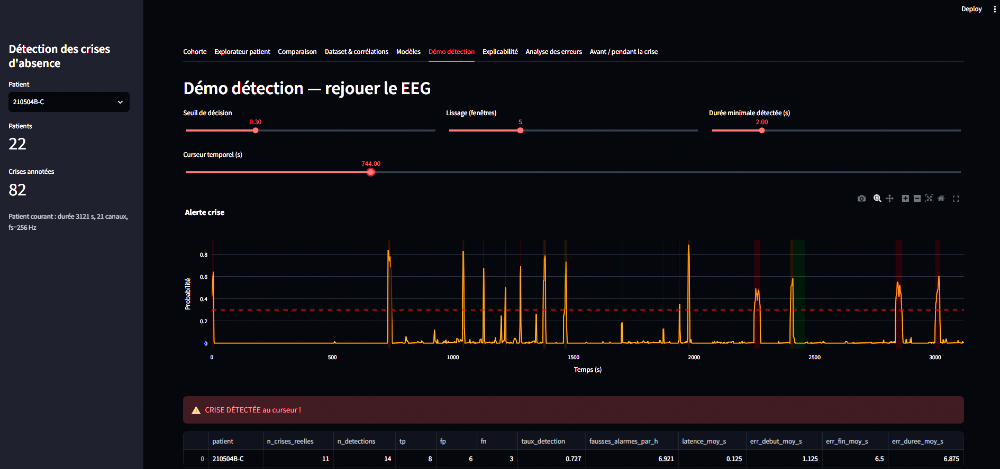
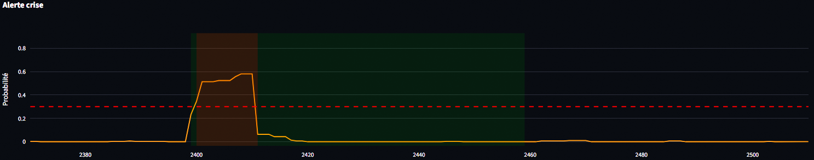

<div align="center">


<br/>

<a href="https://github.com/chahmed12/eeg-absence-detection">
  
</a>

<br/><br/>

[](https://github.com/chahmed12/eeg-absence-detection/actions/workflows/ci.yml)
[](tests/)
[](https://www.python.org/)
[](https://scikit-learn.org/)
[](https://lightgbm.readthedocs.io/)
[](https://streamlit.io/)
[](LICENSE)


**[Aperçu](#aperçu) · [Résultats](#résultats-clés) · [Pipeline](#pipeline) · [Démo](#démonstration-streamlit) · [Installation](#installation--reproduction) · [Structure](#structure-du-dépôt)**

</div>

---

## Sommaire

- [Aperçu](#aperçu)
- [Problématique](#problématique)
- [Données](#données)
- [Pipeline](#pipeline)
- [Approche méthodologique](#approche-méthodologique)
- [Résultats clés](#résultats-clés)
- [Démonstration Streamlit](#démonstration-streamlit)
- [Installation & reproduction](#installation--reproduction)
- [Structure du dépôt](#structure-du-dépôt)
- [Limites & perspectives](#limites--perspectives)
- [Contexte](#contexte)
- [Auteurs](#auteurs)

---

## Aperçu

Ce projet détecte automatiquement les **crises d'absence épileptiques** (décharges pointe-onde généralisées à ~3 Hz) à partir d'enregistrements **EEG multi-canaux**.

Il passe d'une classification **par fenêtre** à une **détection par événement** : les prédictions sont fusionnées pour reconstruire des **intervalles temporels** cohérents avec les annotations cliniques.

> [!IMPORTANT]
> **Enjeu méthodologique central : ne pas surestimer les performances.**
> Avec un fenêtrage à recouvrement de 50 %, un split aléatoire fait fuiter l'information entre train et test. Les performances retenues ici sont celles de la **validation par patient (LOPO)**.

<table>
<tr>
<td align="center" width="25%"><h3>86,6 %</h3>des crises détectées</td>
<td align="center" width="25%"><h3>0,9 s</h3>latence moyenne</td>
<td align="center" width="25%"><h3>3,35</h3>faux positifs / heure</td>
<td align="center" width="25%"><h3>0,74</h3>F1 en LOPO (MI top-250)</td>
</tr>
</table>

---

## Problématique

> Comment détecter, de manière **robuste et honnête**, les crises d'absence à partir d'enregistrements EEG hétérogènes (montages différents d'un patient à l'autre) ?

L'objectif est un pipeline **reproductible**, du chargement brut des fichiers `.mat` (format MCOS) jusqu'à la **détection temporelle** des crises, en privilégiant une **validation par patient** plutôt qu'un simple split aléatoire.

---

## Données

| Élément | Détail |
|---|---|
| **Source** | Enregistrements EEG multi-canaux, format Micro Color EEG Scan (`*_0000d.mat`) |
| **Annotations** | `Annotations MAJ.xlsx` (début / fin des crises par patient) |
| **Cohorte** | 19 patients annotés sur 22 enregistrements (3 sans crise) |
| **Montages** | 12 à 23 canaux (19 EEG + canaux auxiliaires EMG / SLI / ECG), noms variables |
| **Fréquence d'échantillonnage** | 256 Hz |
| **Durées** | 1 173 s à 3 600 s, aucune valeur manquante |

> [!NOTE]
> Les données brutes ne sont **pas** incluses dans ce dépôt. Voir [`data/README.md`](data/README.md) pour la configuration.

---

## Pipeline

```mermaid
%%{init: {'theme':'base','themeVariables':{'fontFamily':'Segoe UI, Arial','primaryColor':'#e0f2fe','primaryBorderColor':'#0284c7','lineColor':'#64748b'}}}%%
flowchart LR
  A["Données brutes<br/>.mat MCOS"] --> B["Lecture et<br/>reconstitution"]
  B --> C["Pré-traitement<br/>0,5–40 Hz + notch 50 Hz"]
  C --> D["Fenêtrage<br/>2 s · recouvrement 50 %"]
  D --> E["Extraction de features<br/>temporel · spectral · Hjorth<br/>entropie · synchronie"]
  E --> F["Modèles ML<br/>DT · RF · KNN · SVM · LightGBM"]
  F --> G["Post-traitement<br/>fusion + seuillage"]
  G --> H["Détection par événement<br/>intervalles + métriques"]
  H --> I["Évaluation honnête<br/>LOPO / GroupKFold"]

  classDef data fill:#fef3c7,stroke:#d97706,color:#78350f;
  classDef proc fill:#e0f2fe,stroke:#0284c7,color:#0c4a6e;
  classDef ml fill:#ede9fe,stroke:#7c3aed,color:#4c1d95;
  classDef out fill:#dcfce7,stroke:#16a34a,color:#14532d;
  class A data;
  class B,C,D,E proc;
  class F,G ml;
  class H,I out;
```



---

## Approche méthodologique

<details open>
<summary><b>1. Lecture du format MCOS</b></summary>

<br/>

Les fichiers `.mat` ne sont pas lisibles directement par `scipy.io.loadmat`. Un parser dédié, [`src/io.py`](src/io.py), extrait les blocs canal par canal et reconstitue le signal multicanal.

</details>

<details open>
<summary><b>2. Pré-traitement rigoureux</b></summary>

<br/>

- **Filtrage** : passe-bande Butterworth 0,5–40 Hz (phase nulle, `filtfilt`) + notch 50 Hz
- **Ciblage EEG** : seuls les canaux EEG alimentent l'extraction de features (EMG / ECG / SLI exclus pour éviter la contamination)
- **Hétérogénéité** : malgré des montages différents (12 / 21 / 23 canaux), le projet s'appuie sur les **8 canaux EEG communs** à tous les enregistrements pour une approche généralisable

</details>

<details open>
<summary><b>3. Fenêtrage et étiquetage</b></summary>

<br/>

- **Fenêtre** : 2 s (512 échantillons), **recouvrement 50 %** (conforme au cahier des charges)
- **Étiquetage** : une fenêtre est « crise » si ≥ 50 % de ses échantillons appartiennent à une crise annotée
- **Conscience de la fuite** : le recouvrement crée une forte dépendance entre fenêtres voisines, donc un split aléatoire est potentiellement **optimiste**

</details>

<details open>
<summary><b>4. Extraction de caractéristiques</b></summary>

<br/>

Pour chaque fenêtre et chaque canal EEG :

| Famille | Features |
|---|---|
| **Temporel** | moyenne, écart-type, min / max, amplitude, RMS, énergie, skewness, kurtosis, *line length* |
| **Fréquentiel** | PSD (FFT), puissances Delta / Theta / Alpha / Beta, rapports Theta/Alpha et Delta/Alpha, fréquence dominante, entropie spectrale, centroïde spectral |
| **Avancé** | paramètres de **Hjorth** (activité / mobilité / complexité), **entropie de permutation**, **énergie en ondelettes**, **synchronie inter-canaux** (corrélation / cohérence) |

</details>

<details open>
<summary><b>5. Modélisation et validation honnête</b></summary>

<br/>

- **Modèles comparés** : arbre de décision, Random Forest, KNN, SVM (linéaire / RBF), LightGBM / XGBoost (selon disponibilité)
- **Split aléatoire stratifié 80/20** : présenté **uniquement à titre comparatif** (fuite par recouvrement)
- **Validation par patient** : **LOPO** (*Leave-One-Patient-Out*) ou **GroupKFold** par patient. C'est la **métrique retenue** pour juger la généralisation à de nouveaux patients
- **Déséquilibre et sélection** : sélection par **Information Mutuelle (MI)**, étude de l'effet SMOTE, ablation de canaux / bandes

</details>

<details open>
<summary><b>6. De la fenêtre à l'événement</b></summary>

<br/>



Métriques événementielles : **taux de détection**, **faux positifs par heure (FP/h)** et **latence moyenne**, avec une tolérance de **±2 s** par rapport aux annotations.

</details>

---

## Résultats clés

> [!WARNING]
> Le split aléatoire est présenté à titre comparatif. **Les performances en validation par patient sont celles à retenir comme réalistes.**

| Protocole | Modèle | F1 | Remarques |
|---|---|:---:|---|
| Split aléatoire stratifié (80/20) | LightGBM | **~0,87** | Optimiste : fuite par recouvrement des fenêtres |
| Validation par patient (LOPO / GroupKFold), base | LightGBM | **~0,66** | Estimation réaliste |
| Validation par patient + **sélection MI top-250** | LightGBM | **~0,74** | Meilleure configuration |
| **8 canaux EEG communs** | LightGBM | **~0,69** | Proche du montage complet : approche robuste à l'hétérogénéité |

**Comparaison visuelle (F1)**

```text
Split aléatoire (fuite)   ██████████████████████████░░░░  0,87   optimiste
LOPO + MI top-250         ██████████████████████░░░░░░░░  0,74   retenu
8 canaux communs          ████████████████████░░░░░░░░░░  0,69
LOPO (base)               ███████████████████░░░░░░░░░░░  0,66
```

**Détection par événement** (LightGBM, seuil 0,2, tolérance ±2 s)

| Crises détectées | Faux positifs | Latence moyenne |
|:---:|:---:|:---:|
| **~86,6 %** | **~3,35 / h** | **~0,9 s** |

Détails complets : [`report/RESULTS_SUMMARY.md`](report/RESULTS_SUMMARY.md)

<!--
Ajoutez ici vos figures (décommentez une fois les fichiers présents) :
<p align="center">
  
  
</p>
-->

---

## Démonstration (Streamlit)

```powershell
streamlit run app/streamlit_app.py
```

L'application permet de :

- **Visualiser** un enregistrement EEG multi-canaux
- **Comparer** annotations réelles et détection prédite
- **Observer** les fenêtres glissantes et la reconstruction par événement
- **Explorer** les probabilités par fenêtre

<p align="center">
  
  
</p>

---

## Installation & reproduction

### 1. Environnement

```powershell
python -m venv .venv
.\.venv\Scripts\Activate.ps1
pip install -r requirements.txt
```

### 2. Données

Placer les fichiers `*_0000d.mat` et `Annotations MAJ.xlsx` dans votre dossier de données, ou définir la variable d'environnement :

```powershell
$env:EEG_DATA_DIR = "C:\chemin\vers\vos\donnees"
```

Voir [`data/README.md`](data/README.md) pour le détail.

### 3. Notebooks pédagogiques

| # | Notebook | Contenu |
|:---:|---|---|
| 1 | [`01_exploration.ipynb`](notebooks/01_exploration.ipynb) | Chargement, audit, exploration |
| 2 | [`02_annotations_cible.ipynb`](notebooks/02_annotations_cible.ipynb) | Cible par échantillon, déséquilibre |
| 3 | [`03_features.ipynb`](notebooks/03_features.ipynb) | Fenêtrage + features |
| 4 | [`04_modeles.ipynb`](notebooks/04_modeles.ipynb) | Modèles + validation par patient (LOPO / GroupKFold) |
| 5 | [`05_detection_erreurs.ipynb`](notebooks/05_detection_erreurs.ipynb) | Post-traitement + métriques événementielles |
| 6 | [`06_ameliorations.ipynb`](notebooks/06_ameliorations.ipynb) | Explicabilité, MI, ablation, sensibilité |

### 4. Scripts reproductibles

Les scripts partagent le même cache :

```powershell
python scripts/scripts_step1.py                      # Exploration
python scripts/scripts_step3_random.py               # Split aléatoire (à titre comparatif)
python scripts/scripts_step3_lopo.py                 # Validation par patient (LOPO / GroupKFold)
python scripts/scripts_step4_detection.py            # Détection par événement
python scripts/scripts_step5_models_explain.py       # Modèles étendus + explicabilité
python scripts/scripts_step5_improvements.py         # MI, SMOTE, ablation, seuils
python scripts/scripts_step5_window_sensitivity.py   # Sensibilité fenêtre / recouvrement
```

### 5. Tests & Couverture

```powershell
python -m pytest tests -v --cov=src --cov-report=term-missing
```

---

## Structure du dépôt

```text
eeg-absence-detection/
├── .github/workflows/ # Pipeline CI GitHub Actions (multi-OS, tests & lint)
├── src/               # Code réutilisable (io, preprocess, features, models, evaluation, postprocess, viz)
├── notebooks/         # Notebooks pédagogiques 01-06 (annotés avec notes d'architecture)
├── scripts/           # Scripts reproductibles du pipeline (step1 → step5)
├── app/               # Application Streamlit de démonstration
├── tests/             # 107 tests unitaires et d'intégration (pytest, conftest)
├── data/              # Instructions sur les données (pas de données brutes)
├── assets/            # Bannière animée et captures pour le README
├── report/            # Résultats synthétiques + figures + rapport coverage HTML
│   ├── RESULTS_SUMMARY.md
│   └── figures/
├── run_pipeline.py    # Orchestrateur du pipeline complet
├── requirements.txt   # Dépendances verrouillées
└── LICENSE            # Licence MIT
```

---

## Limites & perspectives

<table>
<tr>
<td width="50%" valign="top">

### Limites

- **Effectif réduit** : 19 patients annotés, résultats à confirmer sur un jeu plus large
- **Montages hétérogènes** : gestion rigoureuse des canaux manquants (atténuée par les 8 canaux communs)
- **Déséquilibre extrême** : on privilégie Precision / Recall / F1 plutôt que l'Accuracy
- **Seuil empirique** : le seuil 0,2 est optimisé sur ce jeu, une validation plus poussée est nécessaire
- **Généralisation** : une évaluation prospective / externe reste à faire

</td>
<td width="50%" valign="top">

### Perspectives

- Fusion événementielle par **CRF / HMM**
- **CNN temporel** directement sur les fenêtres
- **Explicabilité** canal / bande pour l'interprétation clinique
- Validation sur une **cohorte externe**
- Calibration du seuil par patient

</td>
</tr>
</table>

---

## Contexte

Projet réalisé dans le cadre du module **Data Mining** à l'**École Nationale d'Ingénieurs de Tunis (ENIT)**. Ce dépôt valorise à la fois la **rigueur méthodologique** (validation honnête, conscience de la fuite) et l'**ingénierie** (code modulaire, reproductible, démonstrable).

---

## Auteurs

**Cheikh Ahmed** · Élève ingénieur en informatique, ENIT
[](https://github.com/chahmed12)


---

<div align="center">

Sous licence [MIT](LICENSE) · Si ce projet vous est utile, une étoile fait plaisir !


</div>