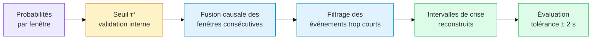

<div align="center">


<br/>

<a href="https://github.com/chahmed12/eeg-absence-detection">
  
</a>

<br/><br/>

[](https://github.com/chahmed12/eeg-absence-detection/actions/workflows/ci.yml)
[](tests/)
[](https://www.python.org/)
[](https://scikit-learn.org/)
[](https://lightgbm.readthedocs.io/)
[](https://streamlit.io/)
[](LICENSE)


**[Aperçu](#aperçu) · [Résultats](#résultats-clés) · [Pipeline](#pipeline) · [Démo](#démonstration-streamlit) · [Installation](#installation--reproduction) · [Structure](#structure-du-dépôt)**

</div>

---

## Sommaire

- [Aperçu](#aperçu)
- [Problématique](#problématique)
- [Données](#données)
- [Pipeline](#pipeline)
- [Approche méthodologique](#approche-méthodologique)
- [Résultats clés](#résultats-clés)
- [Démonstration Streamlit](#démonstration-streamlit)
- [Installation & reproduction](#installation--reproduction)
- [Structure du dépôt](#structure-du-dépôt)
- [Limites & perspectives](#limites--perspectives)
- [Contexte](#contexte)
- [Auteurs](#auteurs)

---

## Aperçu

Ce projet détecte automatiquement les **crises d'absence épileptiques** (décharges pointe-onde généralisées à ~3 Hz) à partir d'enregistrements **EEG multi-canaux**.

Il passe d'une classification **par fenêtre** à une **détection par événement** : les prédictions sont fusionnées pour reconstruire des **intervalles temporels** cohérents avec les annotations cliniques.

> [!IMPORTANT]
> **Enjeu méthodologique central : ne pas surestimer les performances.**
> Avec un fenêtrage à recouvrement de 50 %, un split aléatoire fait fuiter l'information entre train et test. Les performances retenues ici sont celles de la **validation par patient**, avec s?lection interne stricte pour P0.

<table>
<tr>
<td align="center" width="25%"><h3>93,9 %</h3>des crises détectées</td>
<td align="center" width="25%"><h3>4,5 s</h3>latence causale</td>
<td align="center" width="25%"><h3>4,55</h3>fausses alarmes / heure</td>
<td align="center" width="25%"><h3>0,70</h3>F1 en validation imbriquée</td>
</tr>
</table>

> [!IMPORTANT]
> Le bandeau présente les résultats **P0** de LightGBM : filtrage amont causal (`sosfilt`), GroupKFold par patient, seuil et validation interne strictement imbriqués, puis test externe évalué une seule fois (22 enregistrements / 9,23 h). Les anciens chiffres 86,6 % / 0,9 s / 3,35 FA/h restent documentés comme historiques et ne sont pas reproduits par les artefacts actuels. Détails : [`report/RESULTS_SUMMARY.md`](report/RESULTS_SUMMARY.md) et [`report/EXPERIMENTS_LOG.md`](report/EXPERIMENTS_LOG.md).

---

## Problématique

> Comment détecter, de manière **robuste et honnête**, les crises d'absence à partir d'enregistrements EEG hétérogènes (montages différents d'un patient à l'autre) ?

L'objectif est un pipeline **reproductible**, du chargement brut des fichiers `.mat` (format MCOS) jusqu'à la **détection temporelle** des crises, en privilégiant une **validation par patient** plutôt qu'un simple split aléatoire.

---

## Données

| Élément | Détail |
|---|---|
| **Source** | Enregistrements EEG multi-canaux, format Micro Color EEG Scan (`*_0000d.mat`) |
| **Annotations** | `Annotations MAJ.xlsx` (début / fin des crises par patient) |
| **Cohorte** | 19 patients annotés (82 crises) sur 22 enregistrements, dont 3 enregistrements sans crise |
| **Montages** | 12 à 23 canaux (19 EEG + canaux auxiliaires EMG / SLI / ECG), noms variables |
| **Fréquence d'échantillonnage** | 256 Hz |
| **Durées** | 1 173 s à 3 600 s, aucune valeur manquante |

> [!NOTE]
> Les données brutes ne sont **pas** incluses dans ce dépôt. Voir [`data/README.md`](data/README.md) pour la configuration.

---

## Pipeline

```mermaid
%%{init: {'theme':'base','themeVariables':{'fontFamily':'Segoe UI, Arial','primaryColor':'#e0f2fe','primaryBorderColor':'#0284c7','lineColor':'#64748b'}}}%%
flowchart LR
  A["Données brutes<br/>.mat MCOS"] --> B["Lecture et<br/>reconstitution"]
  B --> C["Pré-traitement<br/>0,5–40 Hz + notch 50 Hz"]
  C --> D["Fenêtrage<br/>2 s · recouvrement 50 %"]
  D --> E["Extraction de features<br/>temporel · spectral · Hjorth<br/>entropie · synchronie"]
  E --> F["Modèles ML<br/>DT · RF · KNN · SVM · LightGBM"]
  F --> G["Post-traitement<br/>fusion + seuillage"]
  G --> H["Détection par événement<br/>intervalles + métriques"]
  H --> I["Évaluation honnête<br/>LOPO / GroupKFold"]

  classDef data fill:#fef3c7,stroke:#d97706,color:#78350f;
  classDef proc fill:#e0f2fe,stroke:#0284c7,color:#0c4a6e;
  classDef ml fill:#ede9fe,stroke:#7c3aed,color:#4c1d95;
  classDef out fill:#dcfce7,stroke:#16a34a,color:#14532d;
  class A data;
  class B,C,D,E proc;
  class F,G ml;
  class H,I out;
```



---

## Approche méthodologique

<details open>
<summary><b>1. Lecture du format MCOS</b></summary>

<br/>

Les fichiers `.mat` ne sont pas lisibles directement par `scipy.io.loadmat`. Un parser dédié, [`src/io.py`](src/io.py), extrait les blocs canal par canal et reconstitue le signal multicanal.

</details>

<details open>
<summary><b>2. Pré-traitement rigoureux</b></summary>

<br/>

- **Filtrage causal** : passe-bande Butterworth 0,5–40 Hz (`sosfilt` avec conditions initiales) + notch 50 Hz, sans utilisation de samples futurs (`v3_causal`)
- **Ciblage EEG** : seuls les canaux EEG alimentent l'extraction de features (EMG / ECG / SLI exclus pour éviter la contamination)
- **Hétérogénéité** : malgré des montages différents (12 / 21 / 23 canaux), le projet s'appuie sur les **8 canaux EEG communs** à tous les enregistrements pour une approche généralisable

</details>

<details open>
<summary><b>3. Fenêtrage et étiquetage</b></summary>

<br/>

- **Fenêtre** : 2 s (512 échantillons), **recouvrement 50 %** (conforme au cahier des charges)
- **Étiquetage** : une fenêtre est « crise » si ≥ 50 % de ses échantillons appartiennent à une crise annotée
- **Conscience de la fuite** : le recouvrement crée une forte dépendance entre fenêtres voisines, donc un split aléatoire est potentiellement **optimiste**

</details>

<details open>
<summary><b>4. Extraction de caractéristiques</b></summary>

<br/>

Pour chaque fenêtre et chaque canal EEG :

| Famille | Features |
|---|---|
| **Temporel** | moyenne, écart-type, min / max, amplitude, RMS, énergie, skewness, kurtosis, *line length* |
| **Fréquentiel** | PSD (FFT), puissances Delta / Theta / Alpha / Beta, rapports Theta/Alpha et Delta/Alpha, fréquence dominante, entropie spectrale, centroïde spectral |
| **Avancé** | paramètres de **Hjorth** (activité / mobilité / complexité), **entropie de permutation**, **énergie en ondelettes**, **synchronie inter-canaux** (corrélation / cohérence) |

</details>

<details open>
<summary><b>5. Modélisation et validation honnête</b></summary>

<br/>

- **Modèles comparés** : arbre de décision, Random Forest, KNN, SVM (linéaire / RBF), LightGBM / XGBoost (selon disponibilité)
- **Split aléatoire stratifié 80/20** : présenté **uniquement à titre comparatif** (fuite par recouvrement)
- **Validation par patient** : **LOPO** (*Leave-One-Patient-Out*) ou **GroupKFold** par patient. C'est la **métrique retenue** pour juger la généralisation à de nouveaux patients
- **Déséquilibre et sélection** : sélection par **Information Mutuelle (MI)**, étude de l'effet SMOTE, ablation de canaux / bandes

</details>

<details open>
<summary><b>6. De la fenêtre à l'événement</b></summary>

<br/>



Métriques événementielles : **taux de détection**, **faux positifs par heure (FP/h)** et **latence moyenne**, avec une tolérance de **±2 s** par rapport aux annotations.

</details>

---

## Résultats clés

> [!WARNING]
> Le split aléatoire est présenté à titre comparatif. **Les performances en validation par patient sont celles à retenir comme réalistes.**

### Validation P0 (causale et strictement imbriquée)

| Expérience | Modèle | F1 fenêtre | Détection | FA/h | Latence causale |
|---|---|---|:---:|:---:|:---:|
| EXP-00 | LightGBM, 260 features | **0,700 ± 0,121** | **93,9 %** (77/82) | **4,55** | **4,46 s** |
| EXP-01 | CNN 1D temporel | 0,488 ± 0,119 | 96,3 % | 19,50 | 3,33 s |
| EXP-02 | CNN spatio-temporel | 0,527 ± 0,140 | 93,9 % | 19,93 | 2,96 s |
| EXP-03 | EEGNet, seuil 0,5 | 0,522 ± 0,100 | 93,9 % | 11,48 | 1,19 s |
| EXP-04 | EEGNet, seuil calibré | **0,643 ± 0,077** | **93,9 %** (77/82) | **8,88** | **3,86 s** |

> [!NOTE]
> Les métriques événementielles sont poolées sur 22 enregistrements / 9,23 h. LightGBM : F1 poolé 0,705, précision/rappel 0,706/0,703, 40 FP et 5 FN ; FA/h 4,55 causal (4,33 hors-ligne). EXP-04 : 82 FP, 5 FN ; moyenne des plis 92,4 ± 11,1 % et 8,29 ± 6,05 FA/h. Le seuil τ* (0,77 ± 0,15) est choisi uniquement sur la validation interne, jamais sur le test. Le balayage OOF global de EXP-04 (F1 0,673 à τ=0,94) est optimiste et ne doit pas être cité comme résultat principal.

### Comparaison historique (avant correction P0)

| Protocole | Modèle | F1 | Remarques |
|---|---|:---:|---|
| Split aléatoire stratifié (80/20) | LightGBM | **~0,87** | Optimiste : fuite par recouvrement des fenêtres |
| Validation par patient (LOPO / GroupKFold), base | LightGBM | **~0,66** | Estimation réaliste |
| Validation par patient + **sélection MI top-250** | LightGBM | **~0,74** | Meilleure configuration |
| **8 canaux EEG communs** | LightGBM | **~0,69** | Proche du montage complet : approche robuste à l'hétérogénéité |

**Comparaison visuelle (F1)**

```text
Split aléatoire (fuite)   ██████████████████████████░░░░  0,87   optimiste
LOPO + MI top-250         ██████████████████████░░░░░░░░  0,74   retenu
8 canaux communs          ████████████████████░░░░░░░░░░  0,69
LOPO (base)               ███████████████████░░░░░░░░░░░  0,66
```

**Détection par événement** — chiffres historiques indicatifs (LightGBM, seuil 0,2, tolérance ±2 s)

| Crises détectées | Faux positifs | Latence moyenne |
|:---:|:---:|:---:|
| **~86,6 %** | **~3,35 / h** | **~0,9 s** |

> [!NOTE]
> Ces valeurs reposent sur 19 patients annotés / 8,06 h et un seuil fixé après observation de la courbe OOF. Sur les artefacts actuels (`cache/predictions.parquet`, 19 patients / 8,06 h), le seuil 0,20 reproduit 3,35 FA/h mais pas 86,6 % de détection (92,7 %). Le seuil 0,30 donne 87,8 % / 3,10 FA/h. La ligne 62,2 % / 1,24 FA/h est un RandomForest LOPO, pas LightGBM.

### Extension Deep Learning & Arbitrage d'Ingénierie (EEGNet)

Une démarche Deep Learning a été menée de bout en bout sur signaux bruts (8 canaux, 1 489 paramètres) sous **validation interne strictement imbriquée par patient** :
- **Détection d'événements** : EEGNet calibré (EXP-04) détecte **93,9 %** des crises (77/82) avec **8,88 FA/h** en mode causal ; la moyenne des plis est $92,4\% \pm 11,1\%$ et $8,29 \pm 6,05\text{ FA/h}$. Le seuil $\tau^*=0,77 \pm 0,15$ est choisi uniquement sur la validation interne.
- **Compromis non calibré/calibré** : EEGNet à seuil fixe 0,5 (EXP-03) donne $93,9\%$ de détection mais $11,48\text{ FA/h}$ ; la calibration par pli réduit les fausses alarmes à $8,88\text{ FA/h}$ tout en conservant $93,9\%$ de détection poolée.
- **Latence causale** : $3,86\text{ s}$ pour EEGNet calibré et $4,46\text{ s}$ pour LightGBM, pondérées par événement. Les anciennes valeurs $5,26 \pm 0,79\text{ s}$ et $6,83 \pm 2,88\text{ s}$ sont des moyennes de moyennes par patient/pli et ne sont plus les chiffres principaux.
- **Temps de calcul de bout en bout** : $10,35\text{ ms}$ (EEGNet) vs $16,81\text{ ms}$ (LightGBM) par fenêtre de 2 s (médiane sur 50 runs), sur **bruit synthétique** avec un **EEGNet non entraîné**. En inférence seule, LightGBM est plus rapide ($\approx 0,95\text{ ms}$ vs $1,46\text{ ms}$).
- **Matrice d'arbitrage** : détaillée selon 7 dimensions d'ingénierie dans [`report/EXPERIMENTS_LOG.md`](report/EXPERIMENTS_LOG.md).

> [!NOTE]
> Le protocole P0 est terminé : filtrage amont causal (`sosfilt`), post-traitement causal sans fusion rétroactive des trous, early stopping et sélection du seuil sur validation interne, test externe évalué une seule fois. Les résultats restent limités par la taille de cohorte et nécessitent une validation externe.

> [!IMPORTANT]
> **Décision finale d'architecture** : LightGBM EXP-00 est le modèle de référence retenu pour la détection ; EEGNet EXP-04 est l'extension Deep Learning retenue pour le monitoring embarqué. EEGNet est plus compact et plus rapide de bout en bout, mais LightGBM reste plus performant et émet moins de fausses alarmes.

Détails complets : [`report/RESULTS_SUMMARY.md`](report/RESULTS_SUMMARY.md) et [`report/EXPERIMENTS_LOG.md`](report/EXPERIMENTS_LOG.md)

<!--
Ajoutez ici vos figures (décommentez une fois les fichiers présents) :
<p align="center">
  
  
</p>
-->

---

## Démonstration (Streamlit)

```powershell
streamlit run app/streamlit_app.py
```

L'application permet de :

- **Visualiser** un enregistrement EEG multi-canaux
- **Comparer** annotations réelles et détection prédite
- **Observer** les fenêtres glissantes et la reconstruction par événement
- **Explorer** les probabilités par fenêtre

<p align="center">
  
  
</p>

---

## Installation & reproduction

### 1. Environnement

```powershell
python -m venv .venv
.\.venv\Scripts\Activate.ps1
pip install -r requirements.txt
```

### 2. Données

Placer les fichiers `*_0000d.mat` et `Annotations MAJ.xlsx` dans votre dossier de données, ou définir la variable d'environnement :

```powershell
$env:EEG_DATA_DIR = "C:\chemin\vers\vos\donnees"
```

Voir [`data/README.md`](data/README.md) pour le détail.

### 3. Notebooks pédagogiques

| # | Notebook | Contenu |
|:---:|---|---|
| 1 | [`01_exploration.ipynb`](notebooks/01_exploration.ipynb) | Chargement, audit, exploration |
| 2 | [`02_annotations_cible.ipynb`](notebooks/02_annotations_cible.ipynb) | Cible par échantillon, déséquilibre |
| 3 | [`03_features.ipynb`](notebooks/03_features.ipynb) | Fenêtrage + features |
| 4 | [`04_modeles.ipynb`](notebooks/04_modeles.ipynb) | Modèles + validation par patient (LOPO / GroupKFold) |
| 5 | [`05_detection_erreurs.ipynb`](notebooks/05_detection_erreurs.ipynb) | Post-traitement + métriques événementielles |
| 6 | [`06_ameliorations.ipynb`](notebooks/06_ameliorations.ipynb) | Explicabilité, MI, ablation, sensibilité |

### 4. Scripts reproductibles

Les scripts partagent le même cache :

```powershell
python scripts/scripts_step1.py                      # Exploration
python scripts/scripts_step3_random.py               # Split aléatoire (à titre comparatif)
python scripts/scripts_step3_lopo.py                 # Validation par patient (LOPO / GroupKFold)
python scripts/scripts_step4_detection.py            # Détection par événement
python scripts/scripts_step5_models_explain.py       # Modèles étendus + explicabilité
python scripts/scripts_step5_improvements.py         # MI, SMOTE, ablation, seuils
python scripts/scripts_step5_window_sensitivity.py   # Sensibilité fenêtre / recouvrement
python scripts/scripts_step6_exp00_lightgbm_nested.py # LightGBM P0 strictement imbriqué
python scripts/export_app_predictions.py             # Export des prédictions pour Streamlit
```

### 5. Tests & Couverture

```powershell
python -m pytest tests -v --cov=src --cov-report=term-missing
```

---

## Structure du dépôt

```text
eeg-absence-detection/
├── .github/workflows/ # Pipeline CI GitHub Actions (multi-OS, tests & lint)
├── src/               # Code réutilisable (io, preprocess, features, models, evaluation, postprocess, viz)
├── notebooks/         # Notebooks pédagogiques 01-06 (annotés avec notes d'architecture)
├── scripts/           # Scripts reproductibles du pipeline (step1 → step6, P0 inclus)
├── app/               # Application Streamlit de démonstration
├── tests/             # 130 fonctions de test unitaires et d'intégration (pytest, conftest)
├── data/              # Instructions sur les données (pas de données brutes)
├── assets/            # Bannière animée et captures pour le README
├── report/            # Résultats synthétiques + figures + rapport coverage HTML
│   ├── RESULTS_SUMMARY.md
│   └── figures/
├── run_pipeline.py    # Orchestrateur du pipeline complet
├── requirements.txt   # Dépendances verrouillées
└── LICENSE            # Licence MIT
```

---

## Limites & perspectives

<table>
<tr>
<td width="50%" valign="top">

### Limites

- **Effectif réduit** : 19 patients annotés (22 enregistrements, dont 3 sans crise), résultats à confirmer sur un jeu plus large
- **Montages hétérogènes** : gestion rigoureuse des canaux manquants (atténuée par les 8 canaux communs)
- **Déséquilibre extrême** : on privilégie Precision / Recall / F1 plutôt que l'Accuracy
- **Chiffres historiques non traçables** : les 86,6 % / 3,35 FA/h restent archivés mais ne sont pas reproduits par les artefacts actuels ; les résultats P0 les remplacent
- **Sélection P0 stricte** : seuil, early stopping et validation interne sont sélectionnés sans le pli de test. Limite restante : le seuil est choisi sur des métriques événementielles rétrospectives de validation interne, pas sur une estimation prospective
- **Causalité P0** : filtrage amont et post-traitement causal corrigés ; `merge_gaps` reste disponible uniquement pour l'analyse rétrospective
- **Agrégation des métriques** : les latences principales sont pondérées par événement ; les dénominateurs FA/h historiques diffèrent (9,23 h pour 22 enregistrements vs 8,06 h pour 19 annotés)
- **Généralisation** : une évaluation prospective / externe reste à faire

</td>
<td width="50%" valign="top">

### Perspectives & Extensions Réalisées

- **Deep Learning empirique** : progression mesurée CNN 1D $\to$ Spatio-temporel $\to$ **EEGNet** (1 489 paramètres), désormais évaluée avec validation interne strictement imbriquée (EXP-04 : F1 0,643, 93,9 % de détection, 8,88 FA/h ; voir [`report/EXPERIMENTS_LOG.md`](report/EXPERIMENTS_LOG.md))
- **Démonstrateur Streamlit multi-modèles** : bascule en direct entre la baseline LightGBM et EEGNet
- Fusion événementielle avancée par **CRF / HMM**
- **Explicabilité** spatiale (ablations contrôlées par canal)
- Validation prospective sur une **cohorte clinique externe**

</td>
</tr>
</table>

---

## Contexte

Projet réalisé dans le cadre du module **Data Mining** à l'**École Nationale d'Ingénieurs de Tunis (ENIT)**. Ce dépôt valorise à la fois la **rigueur méthodologique** (validation honnête, conscience de la fuite) et l'**ingénierie** (code modulaire, reproductible, démonstrable).

---

## Auteurs

**Cheikh Ahmed** · Élève ingénieur en informatique, ENIT
[](https://github.com/chahmed12)


---

<div align="center">

Sous licence [MIT](LICENSE) · Si ce projet vous est utile, une étoile fait plaisir !


</div>
